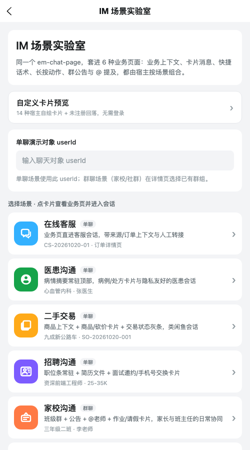

# easemob-uikit-uni

环信 IM 的 uni-app x 版 UIKit（蒸汽模式），一套代码覆盖 Android / iOS / 鸿蒙 / H5 / 微信小程序。

> 当前版本：**1.0.4**。已包含登录接入、会话列表、聊天页（文本/图片/语音/视频/文件 + 复合消息接收展示 + 引用/撤回/重发/已读回执 + AI 流式消息）、群聊、联系人/好友申请、聊天详情、连接状态条与日志导出；内置中英文并支持扩展语言，语言偏好可持久化。逻辑层在 `libs/`，组件层在 `components/`。
>
> 完整接入步骤、常见问题与平台边界见仓库 `docs/QUICKSTART.md`；本文给出最短可运行路径。
> 用 AI 接入时，可直接加载仓库 `skills/` 下的宿主接入 Agent Skills（入口 `em-host-integration`）。

## 兼容性

| 项 | 要求 |
|---|---|
| HBuilderX | 5.21+（蒸汽模式；推荐 5.26+） |
| uni-app x | HBuilderX 4.71+ |
| Vue | Vue 3 组合式 API（不支持 Vue2） |
| 环信 SDK | `easemob-websdk` **5.2.0**（peer 依赖，需宿主安装） |
| App | Android 6+ / iOS 15+ / 鸿蒙 API20+ |
| 小程序 | 微信小程序（SDK 需按下方「分包」接入） |
| H5 | 现代浏览器移动端；未做桌面宽屏布局 |



## 按接入形态选择

- **只要单聊天页**：使用仓库 [`templates/chat-only`](https://github.com/Easemob-Community/easemob-uikit-uniapp/tree/main/templates/chat-only)，包含登录恢复、聊天页、小程序分包与构建检查。
- **完整 IM**：按下方步骤接入，页面组合参考仓库 `demo/`。
- **业务页直进单聊**：使用 chat-only，或按仓库 `docs/GUIDE-MULTI-SCENARIO.md` 手动集成。

## 快速开始（宿主工程）

### 1. 安装依赖

```bash
npm install easemob-websdk@5.2.0
```

把 `uni_modules/easemob-uikit-uni/` 放入宿主工程（插件市场导入或直接拷贝）。

**HBuilderX 5.34**：若引入 SDK 后报 `Identifier "h" has already been declared`，在宿主工程根目录新增 `vite.config.ts`：

```ts
import { defineConfig } from 'vite';
import uni from '@dcloudio/vite-plugin-uni';

export default defineConfig({
	plugins: [uni({
		autoImportOptions: {
			ignore: ['h']
		}
	})],
});
```

已有配置时合并 `autoImportOptions`，不要覆盖其他插件，也无需修改或重打包 `node_modules`。DCloud 已在 [issue #34492](https://issues.dcloud.net.cn/pages/issues/detail?id=34492) 中确认该问题，并回复将由 HBuilderX 后续修复。

### 2. pages.json：页面组件 easycom

页面级组件位于 `components/pages/`，不在默认 easycom 扫描规则内，需要补一条 custom 规则：

```json
{
  "easycom": {
    "autoscan": true,
    "custom": {
      "^em-([a-z-]+)-page$": "@/uni_modules/easemob-uikit-uni/components/pages/em-$1-page/em-$1-page.vue"
    }
  }
}
```

聊天页/详情页使用自绘导航栏，页面 style 必须关闭原生导航：

```json
{
  "path": "pages/chat/chat",
  "style": {
    "navigationStyle": "custom",
    "app-plus": { "titleNView": false }
  }
}
```

### 3. App.uvue：初始化主题与 EmKit

```vue
<script setup lang="uts">
import { onLaunch } from '@dcloudio/uni-app'
import { EmKit, initTheme } from '@/uni_modules/easemob-uikit-uni/libs'

onLaunch(() => {
  initTheme()
  EmKit.init({
    appkey: 'your-appkey',
    // 可选：Token 约 80% 生命周期时回调，返回新 token 后 UIKit 自动续期
    onTokenWillExpire: async () => {
      const res = await uni.request({ url: 'https://your-api/im/token' })
      return (res.data as Record<string, string>).token
    },
    onTokenExpired: () => {
      uni.reLaunch({ url: '/pages/login/login' })
    }
  })
})
</script>
```

> `EmKit.init()` 每个应用进程只生效一次，`appkey` 固定；`logout()` 后直接重新 `login()`，切换 appkey 需重启应用进程。

### 4. 登录页

```ts
import { EmKit } from '@/uni_modules/easemob-uikit-uni/libs'

// token 必须由宿主服务端签发；不要在前端硬编码 appkey/token
await EmKit.login({ userId: 'user-id', token: 'access-token' })
uni.reLaunch({ url: '/pages/conversation/conversation' })
```

### 5. 会话页与聊天页

```vue
<template>
  <view class="page" :class="themeClass">
    <em-conversation-page @select="onSelect" />
  </view>
</template>

<script setup lang="ts">
import { onLoad, onShow } from '@dcloudio/uni-app'
import { EmKit, useTheme } from '@/uni_modules/easemob-uikit-uni/libs'
import type { ConversationTypeValue } from '@/uni_modules/easemob-uikit-uni/libs'

const { themeClass } = useTheme()

onLoad(() => { EmKit.syncConversations().catch(() => {}) })
onShow(() => { EmKit.syncConversations().catch(() => {}) })

function onSelect(conversationId: string, chatType: ConversationTypeValue) {
  uni.navigateTo({ url: `/pages/chat/chat?conversationId=${conversationId}&chatType=${chatType}` })
}
</script>

<style>
@import '@/uni_modules/easemob-uikit-uni/libs/style/variables.css';

.page {
  display: flex;
  flex-direction: column;
  height: 100%;
}
</style>
```

```vue
<template>
  <em-chat-page
    :conversation-id="conversationId"
    :chat-type="chatType"
    @open-info="onOpenInfo"
  />
</template>
```

> **关键**：页面根节点必须有确定高度（`height: 100%` 且父级 flex 链完整），否则列表/输入栏会被压成 0 高，表现为白屏。

### 6. 微信小程序页面与 SDK 分包

小程序主包 2MB 限制下，websdk 不能静态进主包。新工程可直接使用 `templates/chat-only`，已预置 `sub-im` 页面分包、`sub-sdk` SDK 分包和统一命令：

```bash
npm run dev:mp      # HBX dev + 分包 watch
npm run build:mp    # HBX build + 后处理 + 检查
npm run check:mp    # 复查 build 产物
```

HBuilderX GUI 开发时保持 `npm run watch:mp` 运行。既有工程需按实际路由声明普通分包，并复制统一脚本；后处理会同时维护公共和私有项目配置，避免 SDK 被“忽略未使用文件”剔除。无需改 UIKit 业务代码，`EmKit.init()` / `login()` 会自动等待 SDK 就绪。

完整步骤、体积阈值与排错见仓库 `docs/GUIDE-WEAPP-SDK-SUBPACKAGE.md`。

## 平台能力（1.0）

不支持的端已直接隐藏入口（能力源 `libs/platform.ts` 的 `PLATFORM_CAPABILITIES`），不会出现「点一下只弹暂不支持」：

| 能力 | H5 | 微信小程序 | App（Android/iOS/鸿蒙） |
|---|---|---|---|
| 视频消息：发送 | ✅ | ✅ | ✅ |
| 视频消息：播放 | ✅ 内置全屏播放器 | ✅ 内置全屏播放器 | ✅ 内置全屏播放器 |
| 文件消息：发送 | ✅ | ✅ | ✅ 需注册附件能力 |
| 文件消息：打开/下载 | ✅ 浏览器下载 | ✅ 下载并尝试文档预览 | ✅ 下载并尝试文档预览 |
| 语音消息：发送 | ⏳ 入口隐藏 | ✅ | ✅ |

> **App 发行必要配置**：Android、iOS 都要在 manifest 的 `app-android` / `app-ios` → `distribute.modules` 显式声明 `"uni-websocket": {}`。环信 SDK 通过运行时适配对象调用 `connectSocket`，静态摇树可能漏掉该模块，导致发行包无法建立 IM 长连接。其他直接调用的网络、文件和媒体模块通常能自动扫描，无需全量声明。
>
> **App 自定义基座**：视频播放依赖 uni-app x 内置模块 `uni-video`，该模块会按代码用量摇树。基座如果是在接入视频组件之前打的，`<video>` 会被降级为普通 `<view>`，表现为点开播放器后全屏黑屏；重新打一次自定义基座即可，或在 manifest 的 `app-ios` / `app-android` → `distribute.modules`（HBuilderX 4.71 以下为 `app` → `distribute.modules`）显式声明 `"uni-video": {}`（示例工程已配置）。原生模块配置变更不能通过 JS 热更新生效。

## App 端文件发送（宿主注入）

App 端没有跨端内置的系统文件选择器。UIKit 不静态依赖任何 UTS 插件；宿主安装文件选择器插件后，用 `EmKit.setAttachmentProvider()` 注册 `pick`（返回已复制到本地的附件路径）即可，输入栏「文件」格自动出现，发送成功后的临时文件清理由 UIKit 负责。

```ts
import { EmKit } from '@/uni_modules/easemob-uikit-uni/libs'

EmKit.setAttachmentProvider({
  pick: async (ctx) => {
    // 调起宿主文件选择器（如 easemob-file-picker 的 chooseFile → prepareFile），
    // 返回 { path, name, size, mimeType, temporary: true, release(path) }[]
    return []
  }
})
```

完整契约、清理时机与 `resolve(uri)` 用法见仓库 `docs/API-KIT.md`；demo 工程的 `common/attachment-provider.uts` 是一份可直接照抄的适配器。

## 已知限制（1.0）

- 视频播放依赖系统/浏览器解码能力；冷门编码会提示「视频加载失败」。App 端会先整包下载视频再播放（chatfiles 直链不支持 Range），大视频需要等待下载完成；H5 浏览器可能拦截带声音的自动播放，点播放器内的播放键即可。
- 图片、视频与文件下载入口位于消息长按菜单。App/小程序把图片和视频保存到系统相册，文件下载后尝试系统文档预览；H5 走浏览器下载。微信小程序需配置 `downloadFile` 合法域名，文档预览类型以平台支持范围为准。
- App 端发送文件需宿主注册附件能力（见上节）；未注册时「文件」入口保持隐藏。
- H5 为移动端布局，未做桌面宽屏适配。
- 语音发送仅 App/小程序；录音 60s 上限自动发送，麦克风权限失败只 toast（不自动跳系统设置）。
- iOS 相机权限被拒绝后，系统拍摄页可能停在黑屏且不再弹窗；UIKit 在拍摄前预检 `uni.getAppAuthorizeSetting`，`denied` 时弹窗引导去设置。iOS 发布包需在 `manifest.json` 的 `app-ios.distribute.privacyDescription` 声明相机/相册/麦克风用途描述，改后重新打包生效。
- 鸿蒙需在工程 `harmony-configs/entry/src/main/module.json5` 的 `requestPermissions` 声明 `ohos.permission.MICROPHONE`（语音）、`ohos.permission.CAMERA`（拍摄）与 `ohos.permission.GET_NETWORK_INFO`（网络状态检测；生成工程已包含时保留即可）。麦克风与相机需带 `$string:` 资源形式的 `reason` 和 `usedScene.inuse`，并在 `resources/base/element/string.json` 配置文案。未声明时系统直接拒绝，不会出现授权弹窗，表现为「录音失败」或点拍摄无反应。该目录是**整文件覆盖**而非按节点合并，文件须含完整 `module` 结构并保留已有权限。选择相册/文件走系统 Picker，保存图片/视频走系统保存确认框，均无需额外声明相册或文件权限。完整示例与拒绝后的处理见 `docs/HARMONY-REALDEVICE-RUN.md`。
- `@` 提及为追加式插入（uni `<input>` 无光标位置 API）；消息列表仍为 `scroll-view` 全量渲染，长会话需控制单页消息量并评估滚动性能。
- 非当前会话只保留最近 100 条内存消息，回会话时重拉最新页；完整本地历史需宿主自行持久化。
- 日志原始 payload 默认关闭（`logPayload`），生产排查请临时开启并及时关闭。

## 更多文档

- 仓库根 `README.md`：能力全景、未读/tabBar、Token 续期、多场景扩展、AI 流式消息、深色模式
- 仓库 `skills/`：宿主接入 Agent Skills（总纲/会话聊天/通讯录群组/业务卡片/AI 流式/主题 i18n/小程序分包/排错）
- `docs/QUICKSTART.md`：从空工程到收发消息的完整步骤与排错
- `docs/GUIDE-MULTI-SCENARIO.md`：客服/医疗/招聘/交易等业务直进会话
- `docs/GUIDE-WEAPP-SDK-SUBPACKAGE.md`：小程序 SDK 分包接入
- `docs/HARMONY-REALDEVICE-RUN.md`：鸿蒙真机与签名

## License

MIT，见 `license.md` 或仓库根 `LICENSE`。
